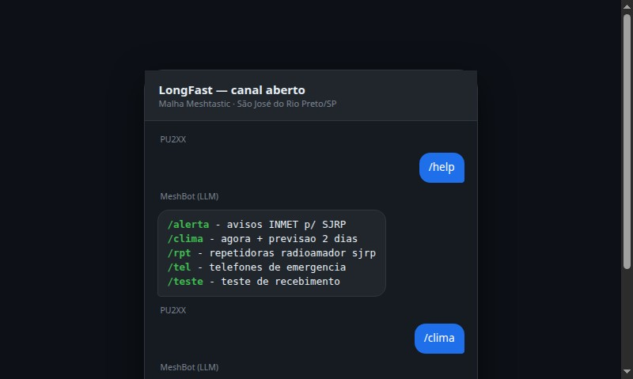
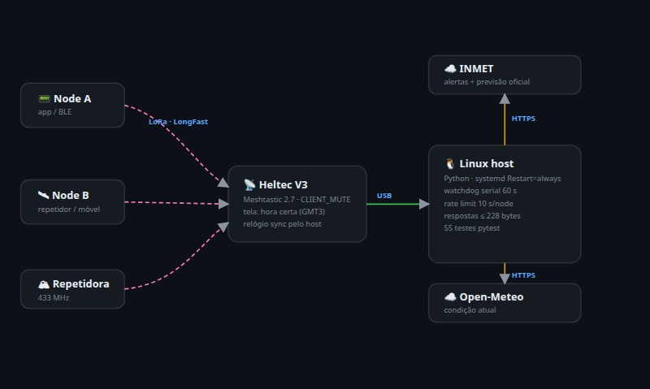

# MeshBot 🤖📡

**🇬🇧 English: this README in [README.en.md](README.en.md)**

Bot de utilidade pública na malha **Meshtastic** de São José do Rio Preto/SP.
Roda em um Heltec V3 conectado por USB a um Linux e responde **comandos `/`** no
canal aberto LongFast — com foco em airtime mínimo (LoRa) e dados oficiais/gratuitos.



## Comandos disponíveis

| Comando | Resposta (exemplo real) | Fonte |
|---|---|---|
| `/teste` | `Teste recebido com sucesso!` | — |
| `/alerta` | `sem alertas INMET p/ SJRP (emergencia: 199)` ou `INMET laranja: Tempestade ate 15/10 23:59` | INMET oficial |
| `/clima` | `Cidade: SJRP` ↵ `T:27C \| U: 39% \| V: 11km/h` ↵ `Hoje: 16-26C \| Amanha: 14-27C` | Open-Meteo + INMET |
| `/tel` | telefones de emergência (190/192/193/199/180/188), um por linha | estático |
| `/rpt` | repetidoras radioamador da região (freq/deslocamento/tom) | estático |
| `/help` | menu de comandos, um por linha | registro interno |

**Push automático:** alerta **VERMELHO** (grande perigo) do INMET é difundido no
canal 3×/dia (≥08h, ≥14h, ≥20h) sem nenhum pedido. Amarelo/laranja só sob demanda.

## Documentação

Comece por **[SETUP.md](SETUP.md)** — passo a passo completo, do hardware ao
systemd. (English: [README.en.md](README.en.md).)



| Documento | Conteúdo |
|---|---|
| [docs/01-arquitetura.md](docs/01-arquitetura.md) | Como o bot funciona por dentro; decisões de design |
| [docs/02-comandos.md](docs/02-comandos.md) | Referência completa de comandos e regras de resposta |
| [docs/03-fontes-de-dados.md](docs/03-fontes-de-dados.md) | APIs usadas, armadilhas verificadas, fontes descartadas |
| [docs/04-operacao.md](docs/04-operacao.md) | Subir/parar, logs, troubleshooting |
| [docs/05-desenvolvimento.md](docs/05-desenvolvimento.md) | Como adicionar um comando (TDD), testes, convenções |
| [docs/06-historico-e-decisoes.md](docs/06-historico-e-decisoes.md) | Linha do tempo, decisões e referências a planos |
| [docs/07-benchmark-comunidades.md](docs/07-benchmark-comunidades.md) | O que comunidades no exterior fazem (pesquisa) |

## Início rápido

```bash
# testes (não precisam de rádio)
cd ~/meshbot
~/.venvs/meshbot/bin/python -m pytest -q

# subir o bot (porta USB exclusiva — feche CLI/app do Meshtastic antes)
~/.venvs/meshbot/bin/python -m meshbot --port /dev/ttyUSB0 >> bot.log 2>&1 &
```

Detalhes e troubleshooting em [docs/04-operacao.md](docs/04-operacao.md).

## Estado

- ✅ Etapa 1 (`/teste`) validada na malha real (2026-10-18)
- ✅ `/alerta` (INMET oficial + push vermelho 3×/dia) — em operação
- ✅ `/clima` (MIX-60: agora + hoje + amanhã) — em operação
- ⏳ Próximos: `/cmd` `/hora` `/ping` `/malha` `/umidade`, serviço systemd — ver [docs/06](docs/06-historico-e-decisoes.md)

42 testes automatizados · Python 3.14 · biblioteca oficial `meshtastic` 2.7.11.
